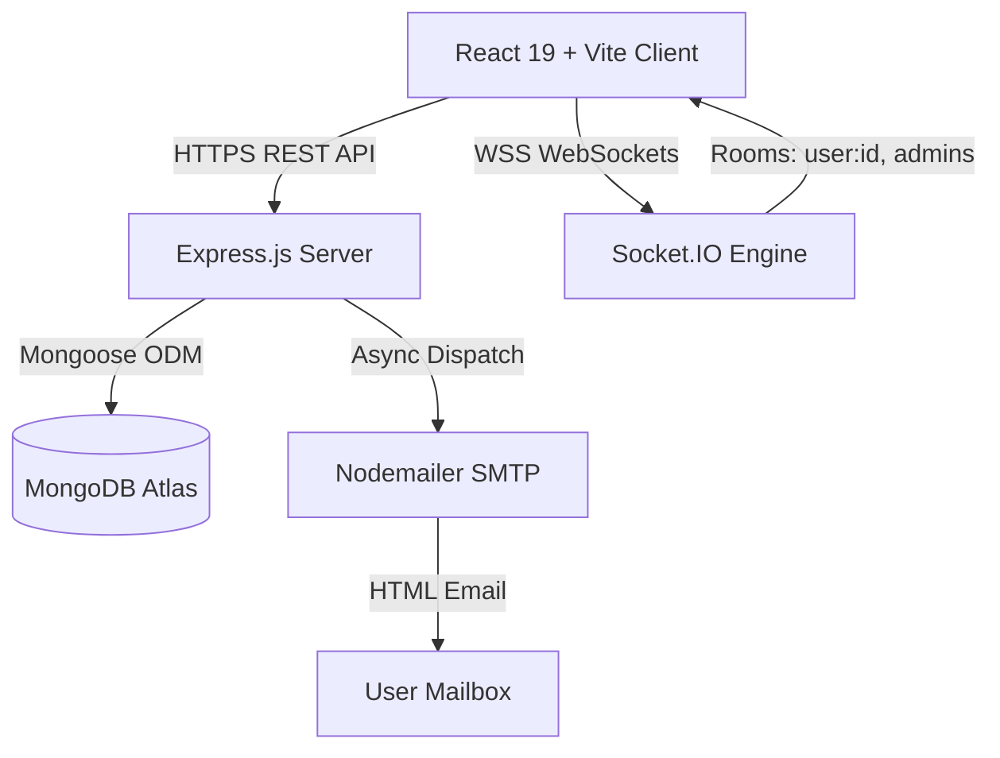

# TaskPulse Enterprise — Multi-Role Task Management System

TaskPulse is an enterprise-grade, real-time Multi-Role Task Management System built using the MERN stack (React 19 + Vite, Tailwind CSS, Node.js + Express, MongoDB + Mongoose, Socket.IO, and Nodemailer).

Designed for distributed teams requiring strict access controls, interactive Kanban workflow automation, live WebSocket synchronization, persistent multi-channel notifications, and transactional email alerts.

---

## 1. Project Overview

TaskPulse solves team workflow friction by providing role-scoped task tracking, real-time collaborative state updates, automated audit logging, and transactional email notifications.

### Primary Capabilities
- **Strict Role-Based Access Control (RBAC)**: Distinct permissions for `admin`, `manager`, and `user` roles.
- **Real-Time Kanban Board**: Interactive 3-column drag-and-drop workflow (`Pending`, `In Progress`, `Completed`) with optimistic updates and automatic server rollback.
- **Live WebSocket Pipeline**: Bi-directional event synchronization powered by authenticated Socket.IO rooms.
- **Dual-Channel Notifications**: In-app popover notification bell with live badge counters combined with HTML-formatted email alerts.
- **Enterprise Security**: Password hashing with bcrypt, JWT bearer token verification, Helmet protection, strict origin validation, and MongoDB query scoping.

---

## 2. Features & Capabilities

### Core Workflow Features
- **3-Tier Role Hierarchy**:
  - **Admin**: Full workspace oversight. Create, assign, edit, and delete any task; manage team member roles; view all metrics.
  - **Manager**: Create and assign tasks to regular users; edit and delete own created tasks; advance task progress; view team members.
  - **User**: View assigned and self-created tasks; advance task workflow status (`Pending` -> `In Progress` -> `Completed`); drag cards on Kanban board; receive live notifications and emails.
- **Real-Time Kanban Board & List View**:
  - Drag-and-drop cards across workflow stages with live order tracking.
  - Instant toggle between visual Kanban board and tabular list view.
  - Real-time task synchronization across multiple connected browser sessions without page refresh.
- **Advanced Filtering, Sorting & Search**:
  - Live full-text search across task titles and descriptions.
  - Filtering by status (`pending`, `in-progress`, `completed`) and priority (`low`, `medium`, `high`).
  - Column sorting by creation date, due date, priority, title, and manual sequence.
- **Live Notifications & Email Engine**:
  - Unread badge counter in navbar with animated ping indicator.
  - Interactive popover panel showing categorized notifications with "Mark as read" and "Mark all as read".
  - Live toast banner on incoming task assignment or update.
  - Styled transactional HTML emails dispatched via Nodemailer with non-blocking execution and mock fallback.

---

## 3. Technology Stack

| Layer | Technologies |
| :--- | :--- |
| **Frontend** | React 19, Vite, Tailwind CSS, Lucide React, Axios, Socket.IO Client, React Router v7 |
| **Backend** | Node.js, Express.js, Socket.IO Server, Mongoose, Nodemailer, Helmet, CORS, Morgan |
| **Database** | MongoDB / MongoDB Atlas (Replica Set supported) |
| **Authentication** | JSON Web Tokens (JWT), bcryptjs password hashing |
| **Deployment Targets** | Frontend: **Vercel** \| Backend: **Render** \| Database: **MongoDB Atlas** |

---

## 4. System Architecture



### Architecture Highlights
- **Single Source of Truth**: All authentication, role authorization, and task ownership checks are enforced server-side.
- **Event-Driven WebSocket Broadcasts**: Events (`task:created`, `task:updated`, `task:statusChanged`, `task:reordered`, `task:deleted`) are routed only to authorized participants (`admins` and `user:<id>`).
- **Resilient Email Pipeline**: Mail failures never roll back database transactions or block API response threads.

---

## 5. Project Directory Structure

```
Mern Project Mini/
├── client/                              # Frontend React + Vite SPA
│   ├── public/                          # Static assets and favicon
│   ├── src/
│   │   ├── components/common/           # Reusable UI (Button, Badge, Navbar, NotificationBell, Spinner)
│   │   ├── context/                     # AuthContext, SocketContext
│   │   ├── hooks/                       # useAuth, useSocket
│   │   ├── layouts/                     # DashboardLayout, AuthLayout
│   │   ├── pages/                       # LoginPage, RegisterPage, DashboardPage, TasksPage, UsersPage
│   │   ├── routes/                      # AppRoutes, ProtectedRoute (RBAC Guard)
│   │   ├── services/                    # api.js (Axios), authService, taskService, notificationService, socketService
│   │   └── utils/                       # constants, helpers
│   ├── .env.example                     # Frontend environment template
│   ├── vercel.json                      # Vercel SPA routing rewrite rules
│   ├── vite.config.js                   # Vite dev server and proxy configuration
│   └── package.json
├── server/                              # Backend Node.js + Express API
│   ├── config/                          # db.js (Mongoose), corsConfig.js (CORS)
│   ├── controllers/                     # authController, taskController, userController, notificationController, healthController
│   ├── middleware/                      # authMiddleware (JWT), roleMiddleware (RBAC), errorHandler
│   ├── models/                          # User.js, Task.js, Notification.js
│   ├── routes/                          # authRoutes, taskRoutes, userRoutes, notificationRoutes, healthRoutes
│   ├── services/                        # tokenService (JWT), emailService (Nodemailer)
│   ├── socket/                          # index.js (Handshake authentication & room management)
│   ├── tests/                           # Automated regression test suites (49 checks)
│   ├── .env.example                     # Backend environment template
│   ├── seeder.js                        # Demo account and baseline task seeder
│   ├── server.js                        # HTTP server, socket initialization, graceful shutdown
│   └── package.json
├── render.yaml                          # Render Blueprint infrastructure-as-code
├── vercel.json                          # Root Vercel SPA rewrite fallback
├── package.json                         # Root runner scripts (concurrently dev, tests, build)
└── README.md                            # Complete system documentation
```

---

## 6. Installation Instructions

### Prerequisites
- Node.js >= 18.0.0
- npm >= 9.0.0
- Local MongoDB running on `mongodb://127.0.0.1:27017` OR a MongoDB Atlas cluster URI

### Step-by-Step Installation
1. Clone the repository:
   ```bash
   git clone https://github.com/your-username/taskpulse.git
   cd taskpulse
   ```
2. Install all dependencies (root, backend, and frontend):
   ```bash
   npm run install:all
   ```

---

## 7. Local Development Commands

### Seed Initial Demo Accounts & Tasks
Populate the database with pre-configured Admin, Manager, and User accounts:
```bash
npm run seed
```

#### Pre-Configured Demo Credentials
| Role | Email | Password | Permissions |
| :--- | :--- | :--- | :--- |
| **Admin** | `admin@taskpulse.com` | `admin123` | Full access across all tasks and user roles |
| **Manager** | `manager@taskpulse.com` | `manager123` | Create/assign tasks to users, manage own tasks |
| **User** | `user@taskpulse.com` | `user123` | View assigned tasks, drag Kanban status |

*(Quick-fill buttons are provided on the login page for one-click credentials filling).*

### Run Development Servers Simultaneously
Launch both Express backend (port 5000) and Vite frontend (port 5173):
```bash
npm run dev
```
- **Web App**: [http://localhost:5173](http://localhost:5173)
- **Backend API**: [http://localhost:5000/api](http://localhost:5000/api)
- **API Health**: [http://localhost:5000/api/health](http://localhost:5000/api/health)

### Run Services Individually
- Backend only: `npm run dev:server`
- Frontend only: `npm run dev:client`
- Client production build: `npm run build:client`

---

## 8. Environment Variable Configuration

### Backend Configuration (`server/.env`)
Copy `server/.env.example` to `server/.env`:
```env
PORT=5000
NODE_ENV=development

# Database Connection (MongoDB Atlas in Production, Local in Dev)
MONGO_URI=mongodb://127.0.0.1:27017/task_management_db

# Client Application URL (Permitted CORS Origin on Render)
CLIENT_URL=http://localhost:5173

# Authentication Secrets (Must be a secure 32+ character random secret in production)
JWT_SECRET=super_secret_jwt_dev_key_for_task_management_system_2026
JWT_EXPIRES_IN=7d

# Nodemailer Email Configuration (Leave dummy or empty in dev for mock transporter)
SMTP_HOST=smtp.gmail.com
SMTP_PORT=587
SMTP_SECURE=false
SMTP_USER=your_email@gmail.com
SMTP_PASS=your_app_specific_password
EMAIL_FROM="TaskPulse Enterprise" <noreply@taskpulse.com>
```

### Frontend Configuration (`client/.env`)
Copy `client/.env.example` to `client/.env`:
```env
# In Local Dev: Leave empty or '/api' to use Vite dev proxy
# In Vercel Production: Set to your live Render backend URL
VITE_API_URL=http://localhost:5000/api
VITE_SOCKET_URL=http://localhost:5000
VITE_APP_NAME=TaskPulse Enterprise
```

---

## 9. MongoDB Atlas Setup Guide

To deploy with MongoDB Atlas:
1. **Create an Atlas Cluster**:
   - Go to [MongoDB Atlas](https://www.mongodb.com/cloud/atlas) and create a free Shared Cluster (M0).
2. **Create Database User**:
   - Navigate to **Database Access** -> **Add New Database User**.
   - Select Password authentication (e.g. `taskpulse_admin`).
   - Grant `Read and write to any database`.
3. **Configure Network Access**:
   - Navigate to **Network Access** -> **Add IP Address**.
   - Choose `Allow Access from Anywhere` (`0.0.0.0/0`) so dynamic cloud providers like Render can connect.
4. **Obtain Connection String**:
   - Go to **Clusters** -> Click **Connect** -> **Drivers (Node.js)**.
   - Copy the URI:
     ```
     mongodb+srv://<username>:<password>@cluster0.abcde.mongodb.net/task_management_db?retryWrites=true&w=majority
     ```
5. **Set in Production Environment**:
   - Supply this URI as `MONGO_URI` in Render's environment settings.
   - Run `npm run seed` once if you want demo data, or start clean.

---

## 10. Authentication & Role Permissions (RBAC Matrix)

| Action | Admin | Manager | User |
| :--- | :---: | :---: | :---: |
| **Register Account (Public)** | ❌ (Blocked) | ✅ | ✅ |
| **View Dashboard & Metrics** | ✅ (All Tasks) | ✅ (Team Scope) | ✅ (Personal Scope) |
| **Create Tasks** | ✅ | ✅ | ❌ |
| **Assign Tasks to Managers** | ✅ | ❌ | ❌ |
| **Assign Tasks to Users** | ✅ | ✅ | ❌ |
| **Edit Any Task** | ✅ | ❌ | ❌ |
| **Edit Own Created Tasks** | ✅ | ✅ | ❌ |
| **Advance Task Status (Kanban)** | ✅ | ✅ | ✅ (If Assigned) |
| **Reorder Tasks (Drag & Drop)** | ✅ | ✅ | ✅ (If Assigned) |
| **Delete Any Task** | ✅ | ❌ | ❌ |
| **Delete Own Created Tasks** | ✅ | ✅ | ❌ |
| **Manage Team Roles** | ✅ | ❌ | ❌ |
| **Demote Own Admin Account** | ❌ (Protected) | N/A | N/A |

---

## 11. REST API Endpoints Reference

All `/api/*` endpoints except public auth and health require a valid Bearer token in the `Authorization` header.

### Authentication Endpoints
- `POST /api/auth/register` — Register a new account (`manager` or `user`).
- `POST /api/auth/login` — Authenticate and obtain JWT token.
- `GET /api/auth/me` — Retrieve active authenticated user profile.

### Task Management Endpoints
- `GET /api/tasks` — Retrieve paginated, filtered, searched, and sorted tasks.
- `GET /api/tasks/stats` — Retrieve aggregated MongoDB task metrics for dashboards.
- `GET /api/tasks/:id` — Retrieve task details.
- `POST /api/tasks` — Create task (`admin`, `manager`).
- `PUT /api/tasks/:id` — Update task details (`admin`, creator `manager`).
- `PATCH /api/tasks/:id/status` — Update task status (`admin`, `manager`, assigned `user`).
- `PATCH /api/tasks/reorder` — Update drag-and-drop order in Kanban board.
- `DELETE /api/tasks/:id` — Delete task (`admin`, creator `manager`).

### Notification Endpoints
- `GET /api/notifications` — Retrieve paginated user notifications with unread count.
- `GET /api/notifications/unread-count` — Fast count of unread notifications for badge counters.
- `PATCH /api/notifications/:id/read` — Mark notification as read (strictly verified for owner).
- `PATCH /api/notifications/read-all` — Mark all notifications as read for current user.

### User Management Endpoints
- `GET /api/users` — List team directory (active members).
- `PATCH /api/users/:id/role` — Update user role (`admin` only, self-demotion blocked).

### Health Endpoint
- `GET /api/health` — Public endpoint returning service uptime and database connectivity.

---

## 12. Socket.IO Events Reference

Connections authenticate strictly via JWT in handshake (`auth: { token }`). Rooms are server-assigned upon connection.

| Event Name | Direction | Room Scope | Payload | Description |
| :--- | :--- | :--- | :--- | :--- |
| `task:created` | Server -> Client | `admins`, `user:<assignedTo>` | `{ taskId, action, title, status, order, timestamp }` | Dispatched on task creation |
| `task:updated` | Server -> Client | `admins`, `user:<assignedTo>`, `user:<createdBy>` | `{ taskId, action, title, status, order, timestamp }` | Dispatched on task details update |
| `task:statusChanged` | Server -> Client | `admins`, `user:<assignedTo>`, `user:<createdBy>` | `{ taskId, action, status, oldStatus, timestamp }` | Dispatched on column transition |
| `task:reordered` | Server -> Client | `admins`, `user:<assignedTo>`, `user:<createdBy>` | `{ taskId, action, order, status, timestamp }` | Dispatched on Kanban reorder |
| `task:deleted` | Server -> Client | `admins`, `user:<assignedTo>`, `user:<createdBy>` | `{ taskId, action, timestamp }` | Dispatched on task removal |
| `notification:new` | Server -> Client | `user:<recipientId>` | `{ notification: { ...populated } }` | Instant real-time notification push |
| `client:ping` | Client -> Server | Direct | None | Ping latency check |
| `server:pong` | Server -> Client | Direct | `{ timestamp }` | Pong latency reply |

---

## 13. Dual-Channel Notification System

1. **Persistent In-App Notifications**:
   - Indexed by `{ recipient: 1, isRead: 1, createdAt: -1 }`.
   - Triggers live unread badge update in navbar.
   - Real-time floating toast notification for active sessions.
2. **Nodemailer Transactional Emails**:
   - Responsive HTML templates for Task Assignment and Task Update.
   - Non-blocking execution (`.catch()` insulated) so SMTP network latency or transient errors never delay database operations.
   - Mock transporter fallback for local testing.

---

## 14. Automated Test Commands (49 / 49 Checks)

TaskPulse includes an enterprise regression test suite covering all modules:

```bash
# Run 8 Authentication and RBAC Security Checks
npm run test:security

# Run 13 Task System, CRUD, Pagination, Search & Reorder Checks
npm run test:tasks

# Run 14 Socket.IO Real-Time & Notification Delivery Checks
npm run test:notifications

# Run 14 Edge Case, Concurrency & Security Audit Checks
npm run test:audit

# Run ALL 49 test checks across all phases
npm test
```

---

## 15. Production Deployment Instructions

### A. Deploy Backend to Render
1. Push your repository to GitHub.
2. In [Render Dashboard](https://dashboard.render.com), click **New +** -> **Web Service**.
3. Connect your repository.
4. Render will detect `render.yaml` or you can manually configure:
   - **Name**: `taskpulse-api`
   - **Root Directory**: `server`
   - **Runtime**: `Node`
   - **Build Command**: `npm install`
   - **Start Command**: `npm start`
   - **Health Check Path**: `/api/health`
5. Configure Environment Variables in Render:
   - `NODE_ENV`: `production`
   - `PORT`: `10000` (Render default)
   - `MONGO_URI`: `mongodb+srv://...` (your Atlas connection string)
   - `JWT_SECRET`: Random 32+ character secret string
   - `JWT_EXPIRES_IN`: `7d`
   - `CLIENT_URL`: `https://your-taskpulse-app.vercel.app`
   - `SMTP_HOST`, `SMTP_PORT`, `SMTP_USER`, `SMTP_PASS`, `EMAIL_FROM`: Your SMTP credentials
6. Click **Deploy Web Service**.
7. Note your live Render URL (e.g., `https://taskpulse-api.onrender.com`).

### B. Deploy Frontend to Vercel
1. In [Vercel Dashboard](https://vercel.com/dashboard), click **Add New** -> **Project**.
2. Import your GitHub repository.
3. Configure Project Settings:
   - **Framework Preset**: `Vite`
   - **Root Directory**: Click edit and select `client`
   - **Build Command**: `npm run build`
   - **Output Directory**: `dist`
4. Configure Environment Variables in Vercel:
   - `VITE_API_URL`: `https://taskpulse-api.onrender.com/api` (your live Render backend URL)
   - `VITE_SOCKET_URL`: `https://taskpulse-api.onrender.com`
5. Click **Deploy**.
6. Vercel automatically applies `client/vercel.json` SPA rewrite rules. Route refreshes (`/dashboard`, `/tasks`, `/users`) will never throw 404 errors.
7. Return to Render and ensure `CLIENT_URL` matches your deployed Vercel domain!

---

## 16. Troubleshooting Guide

| Issue | Cause | Solution |
| :--- | :--- | :--- |
| **CORS error in browser console** | `CLIENT_URL` on Render doesn't match Vercel URL | Update `CLIENT_URL` in Render environment settings to match your exact Vercel frontend domain. |
| **Socket shows 'Reconnecting'** | Frontend `VITE_SOCKET_URL` is pointing to localhost | Ensure `VITE_SOCKET_URL` in Vercel environment variables points to your live Render HTTPS URL. |
| **404 on page refresh on Vercel** | SPA rewrites missing | Ensure `client/vercel.json` is present with the rewrite rule to `/index.html`. |
| **MongoDB connection timeout on Render** | Atlas IP whitelist blocking Render | In MongoDB Atlas Network Access, add `0.0.0.0/0` (Allow access from anywhere). |
| **Emails failing to deliver** | Gmail blocking standard password | For Gmail, enable 2-Step Verification and generate a dedicated 16-character **App Password** for `SMTP_PASS`. |

---

## License
MIT License. Built for enterprise task management with modern MERN architecture.
